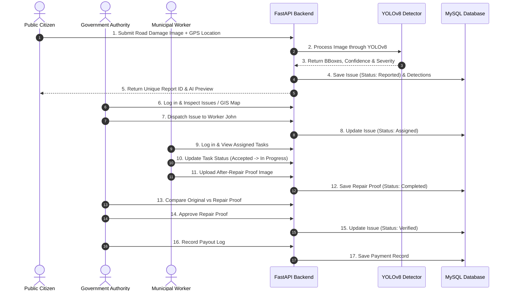

# System Architecture & Technical Flow Documentation

This document describes the high-level architecture, data flows, AI computer vision pipeline, and user-role interaction lifecycles for the **AI-Enabled Infrastructure Monitoring System for Smart Cities**.

---

## 1. System Architecture Diagram

```mermaid
graph TD
    Client[React + Vite Frontend\n(Port 5173)] -->|REST API Requests / Axios| API[FastAPI Backend\n(Port 8000)]
    
    subgraph FastAPI Application Layer
        API --> Auth[JWT Security & Roles]
        API --> PublicRouter[Public Reports Router]
        API --> AuthorityRouter[Authority Router]
        API --> WorkerRouter[Worker Router]
        API --> PaymentRouter[Payment Records Router]
    end

    subgraph AI Computer Vision Services
        PublicRouter --> Detector[Detector Service\n(OpenCV / PIL)]
        Detector --> YOLO[YOLOv8 Model Loader]
        Detector --> Severity[Rule-Based Severity Estimator]
    end

    subgraph Relational Database & Storage
        Auth --> MySQL[(MySQL Database\nsmartcity_monitoring)]
        PublicRouter --> MySQL
        AuthorityRouter --> MySQL
        WorkerRouter --> MySQL
        PaymentRouter --> MySQL
        API --> Storage[Static Upload File System\nbackend/uploads/]
    end
```

---

## 2. End-to-End Incident Resolution Lifecycle



---

## 3. AI Computer Vision Pipeline Detail

1. **Upload Validation**: Image format verified (`.jpg`, `.jpeg`, `.png`, `.webp`), size capped at 10MB, saved with unique UUID filename to `backend/uploads/reports/`.
2. **Preprocessing**: Loaded into OpenCV BGR color format; image dimensions and total surface area calculated.
3. **YOLOv8 Inference**: Ultralytics PyTorch model identifies object bounding boxes, confidence values, and raw class labels (`pothole`, `road_crack`).
4. **Class Filtering**: Strict enforcement ensures only `pothole` (ID 0) and `road_crack` (ID 1) are retained (excluding `manhole` or non-domain objects).
5. **Severity Estimation**: Rule-based calculation combining bounding box area ratio relative to image dimensions (`<2%` = Low, `2%-7%` = Medium, `7%-15%` = High, `>15%` = Critical) and detection count.
6. **Annotation Rendering**: OpenCV draws colored bounding boxes and labels (`class`, `severity`, `confidence`) directly onto an output image saved to `backend/uploads/reports/annotated/`.
